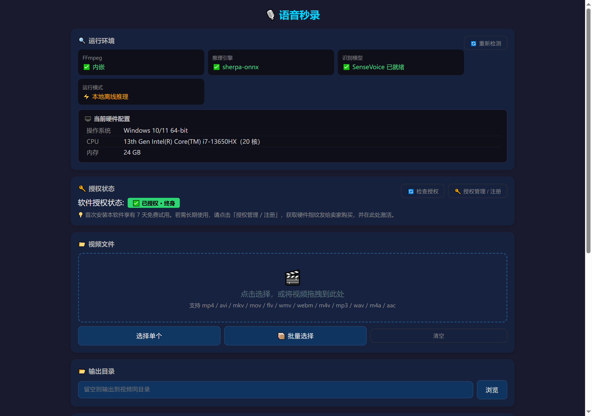
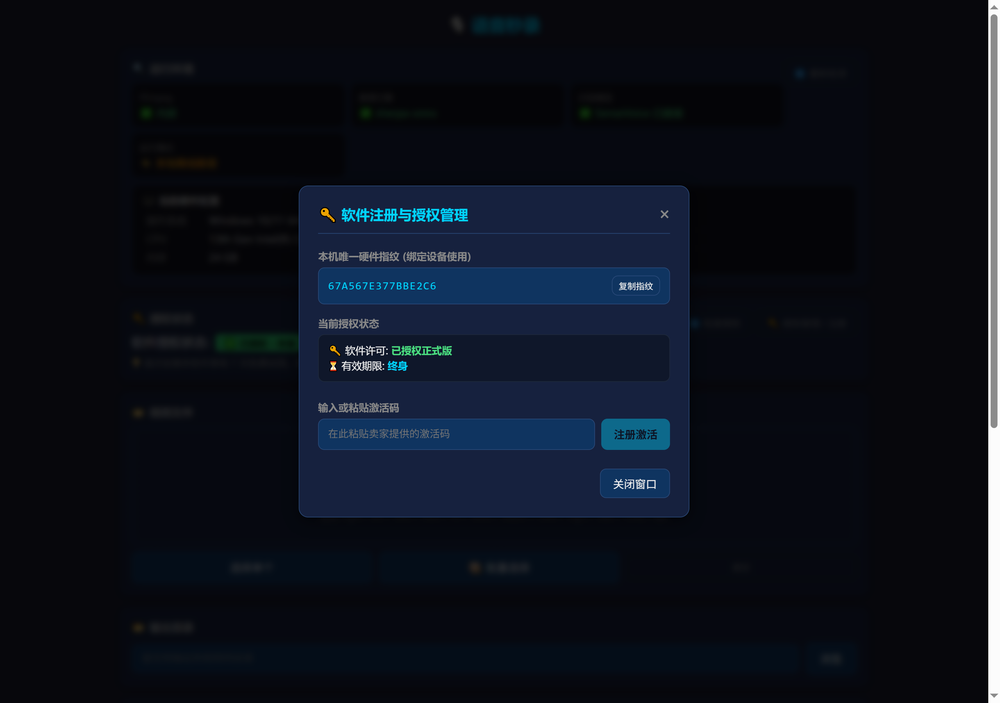

# 语音秒录 · 本地 AI 语音识别与视频字幕生成器

> **100% 离线运行 · 一次买断 · 无需显卡与 Python 环境**
> 拖入视频或音频，一键生成带时间轴的字幕文件。音视频全程在本机处理，不上传、不联网、不注册账号。

**爱发电主页（购买与更新）**：<https://afdian.com/a/yuyin-miaolu>

---

## 界面预览

---

## 这是什么

「语音秒录」是一款 Windows 桌面工具，用本地大模型把**视频 / 音频里的说话内容转成文字**，直接输出 SRT / VTT / TXT 三种格式。

它解决的是这一类浪费时间的活儿：

- 剪视频时逐句敲字幕、对时间轴对到眼花
- 开完会把录音倒回去反复听，就为了补一句纪要
- 采访、讲座、播客录完，转写要花掉一整个下午
- 想把会议内容丢给云端转写，又担心里面的信息外泄

这些活儿全部可以在你自己电脑上完成。**装好之后拔掉网线，功能一样不缺。**

---

## 核心特性

| 特性 | 说明 |
|------|------|
| 🔒 **完全离线** | 识别在本机推理，音视频文件不出本机。断网可用，无需注册登录 |
| ⚡ **高速识别** | 实测 19.8 分钟视频约 **44 秒**完成（约 27 倍实时速度） |
| 🎯 **五语种识别** | 中文 / 英文 / 日语 / 韩语 / 粤语，自动判别语种 |
| 📄 **三种输出** | SRT（标准字幕）/ VTT（Web 字幕）/ TXT（纯文本纪要） |
| 📦 **批量处理** | 一次拖入多个文件自动排队，全部后台完成 |
| 💰 **一次买断** | ¥99 终身使用，无订阅、无月限、无时长额度、无积分计费 |
| 🖥️ **零环境依赖** | 识别引擎、模型、FFmpeg 全部内置，**不需要装 Python、不需要显卡** |
| 📉 **低配可跑** | 最低 4 核 CPU + 4GB 内存，核显笔记本即可 |

---

## 实测数据

测试环境：i7-13650HX（20 核）+ RTX 4060 Laptop 8GB + 24GB 内存，Windows 10。

| 场景 | 素材 | 结果 |
|------|------|------|
| 长视频单条 | 19.8 分钟课程视频（1280×720） | **44 秒**完成，输出 74 段带时间轴字幕，全片无遗漏 |
| 批量处理 | 同源长视频 × 3 条 | **171 秒**完成，三份结果一致 |
| 识别速度 | — | 约 **27 倍**实时（RTF ≈ 0.037） |

> 识别速度取决于素材时长、CPU 性能与音频清晰度，上表为本机实测值，供参考。

---

## 和云端转写工具的区别

| 对比项 | 剪映 SVIP | 讯飞听见 | 通用在线转写 | **语音秒录** |
|--------|-----------|----------|--------------|--------------|
| 数据去向 | 上传云端 | 上传云端 | 上传云端 | **留在本机** |
| 持续成本 | 599 元/年 | 按分钟计费 / 订阅 | 按量计费 | **一次 ¥99，终身** |
| 网络要求 | 必须联网 | 必须联网 | 必须联网 | **可断网使用** |
| 账号体系 | 需登录 | 需登录 | 需登录 | **免账号** |
| 用量限制 | 按会员额度 | 按时长/积分 | 按套餐 | **无限制** |
| 环境要求 | 客户端 | 客户端 / 网页 | 浏览器 | 无需显卡，无需 Python |

**什么时候该选云端工具？** 如果你的素材本身就要上传到平台发布、或者需要在手机上处理，云端工具更顺手。「语音秒录」的定位很明确：**素材涉及内部信息、商业内容、客户资料，不希望经过第三方服务器时用它。**

---

## 系统要求

| 项目 | 最低 | 推荐 |
|------|------|------|
| 操作系统 | Windows 10 64 位 | Windows 10 / 11 64 位 |
| CPU | 4 核 | 8 核及以上 |
| 内存 | 4 GB | 16 GB 及以上 |
| 磁盘 | 2 GB 可用空间 | 5 GB 及以上 |
| 显卡 | 不需要（核显即可） | — |
| 其他 | 无 | 无需 Python / 无需 CUDA |

---

## 输入与输出

**支持的输入格式**

`mp4` `avi` `mkv` `mov` `flv` `wmv` `webm` `m4v` `mp3` `wav` `m4a` `aac`

**支持的输出格式**

| 格式 | 用途 |
|------|------|
| SRT | 标准字幕，可直接导入 Premiere / Final Cut Pro / 剪映 / 达芬奇 |
| VTT | Web 字幕（HTML5 播放器、部分在线平台） |
| TXT | 纯文本，用于会议纪要、访谈整理、文案提取 |

每条结果都带毫秒级时间轴，与音频内容同步。

---

## 获取与试用

1. **下载安装包** —— 安装包内含识别模型，装完即用，不需要额外下载模型
2. **免费试用 7 天** —— 安装即送 7 天全功能试用，无需注册，无需填任何信息
3. **决定购买** —— 满意后再购买激活码，通过爱发电下单

**爱发电主页**：<https://afdian.com/a/yuyin-miaolu>

### 激活流程

1. 打开软件 → 「授权管理 / 注册」→ 复制**本机硬件指纹**
2. 把指纹发给卖家 → 卖家签发与这台设备绑定的激活码
3. 把激活码粘回软件 → 点「注册激活」→ 立即生效

授权是**离线校验**的（Ed25519 签名 + 硬件指纹绑定），激活过程不需要联网，也不会因为断网而掉线。

### 授权说明

| 项目 | 内容 |
|------|------|
| 授权方式 | 一码一机（绑定 hostname + CPU 型号生成的稳定指纹） |
| 有效期 | **终身**（一次性买断） |
| 后续更新 | 后续版本免费更新 |
| 换机 | 换电脑需重新签发，请联系卖家 |
| 联网校验 | 不需要，全程离线 |

---

## 常见问题

<b>识别准确率怎么样？</b>

基于 SenseVoice 模型，普通话清晰语音的识别质量在同类离线工具中属于第一梯队，自带标点与数字规范化（ITN）。背景噪音大、多人抢话、强方言口音的场景准确率会下降。**建议先用 7 天试用跑你自己的真实素材**，用结果说话。

<b>真的可以断网使用吗？</b>

可以。识别引擎、模型、FFmpeg 全部打包在安装包内，安装后不需要任何网络请求。你可以拔掉网线验证。

<b>需要装 Python、CUDA 或者显卡驱动吗？</b>

都不需要。这是本项目最主要的取舍点：为了免掉 Python 运行时和驱动依赖，识别走 CPU 推理，牺牲了一部分极限速度，换来「下载即用、任何 Windows 电脑都能跑」。

<b>可以在几台电脑上用？</b>

一个激活码绑定一台设备。需要多设备请联系卖家申请批量授权。

<b>支持哪些语种？</b>

中文、英文、日语、韩语、粤语，当前版本自动判别语种，暂不支持手动指定。

<b>视频没有音轨会怎样？</b>

软件会明确提示「该视频没有音频轨道，无法生成字幕」，不会静默失败或输出空文件。纯音乐视频会提示未识别到语音内容。

<b>能处理多长的素材？</b>

没有时长限制。19.8 分钟的素材实测 44 秒完成；更长的素材按比例增加，处理期间可以继续用电脑。

<b>能区分不同说话人吗？</b>

当前版本不支持说话人分离（diarization），结果按时间顺序输出。

<b>支持 macOS / Linux / 手机吗？</b>

目前只有 Windows 64 位版本。其他平台尚未支持。

<b>试用期过了数据会丢吗？</b>

不会。试用期结束只是停用识别与批量处理功能，已有的识别结果文件都在你自己指定的输出目录里，软件不会删除任何东西。

<b>识别结果会被上传或收集吗？</b>

不会。软件不收集、不上传任何识别结果，输出文件完全属于你，可以自由使用、编辑、商用。

<b>遇到问题怎么反馈？</b>

通过爱发电主页私信反馈。反馈时请附上软件「运行日志」里的日志文件（界面内有「打开日志文件」按钮），这样定位问题最快。

---

## 关于本仓库

本仓库是「语音秒录」的**产品文档与说明页**，包含功能介绍、实测数据、常见问题与更新公告。

**本仓库不包含软件源代码**，因此不提供源码构建方式。安装包请通过上面的爱发电主页获取。

---

## 更新日志

### v1.0.0

- 首次发布
- 本地离线识别（sherpa-onnx + SenseVoice），五语种自动判别
- 批量处理、SRT / VTT / TXT 三种输出
- 硬件指纹绑定 + 离线签名授权
- 内置识别模型与 FFmpeg，免额外下载

---

**语音秒录** — 让转写这件事留在你自己电脑上。
